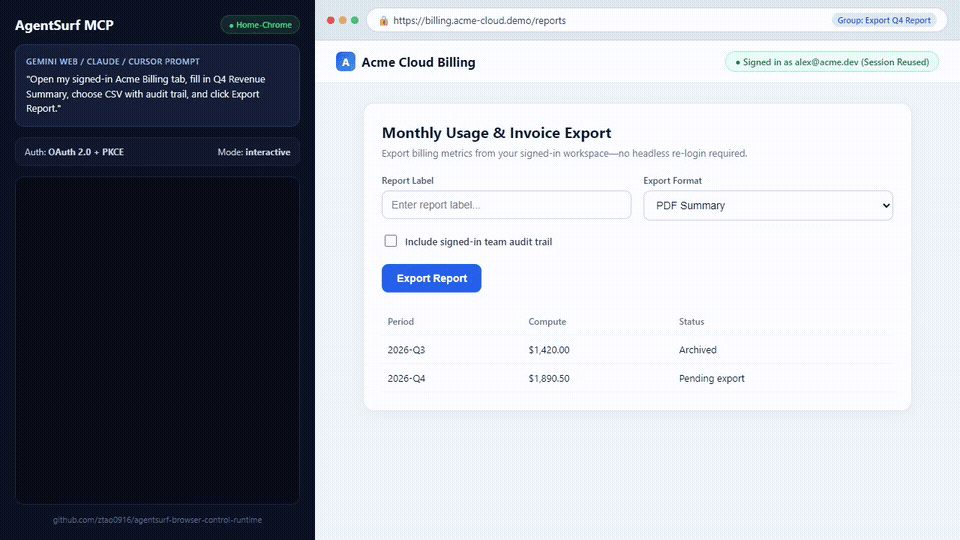
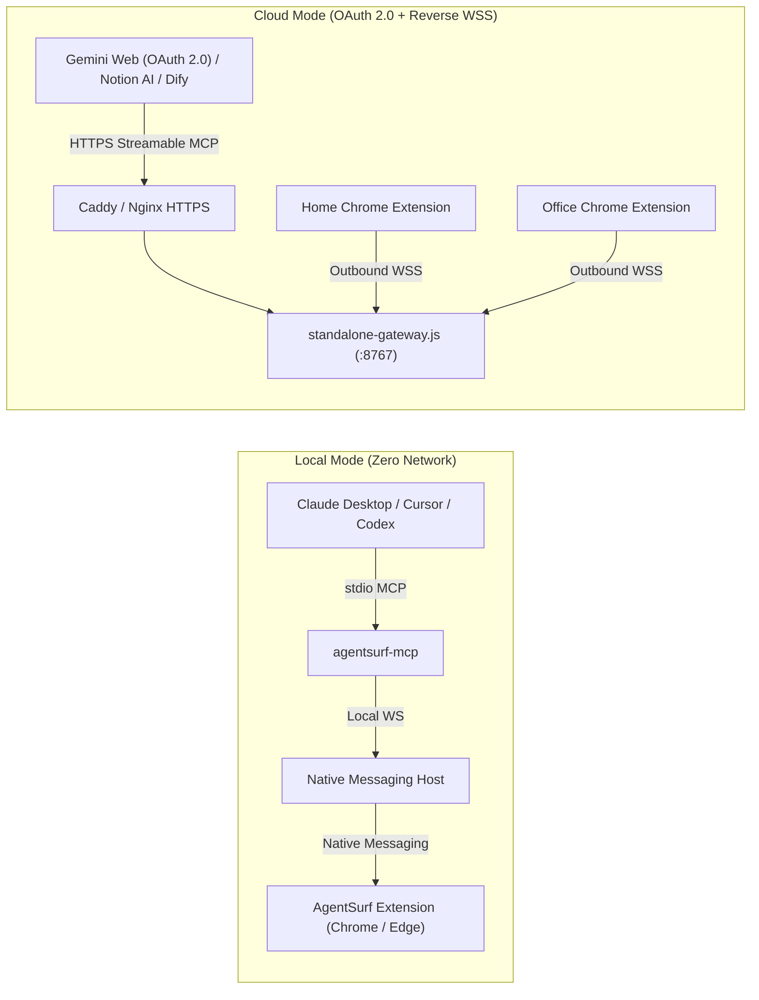
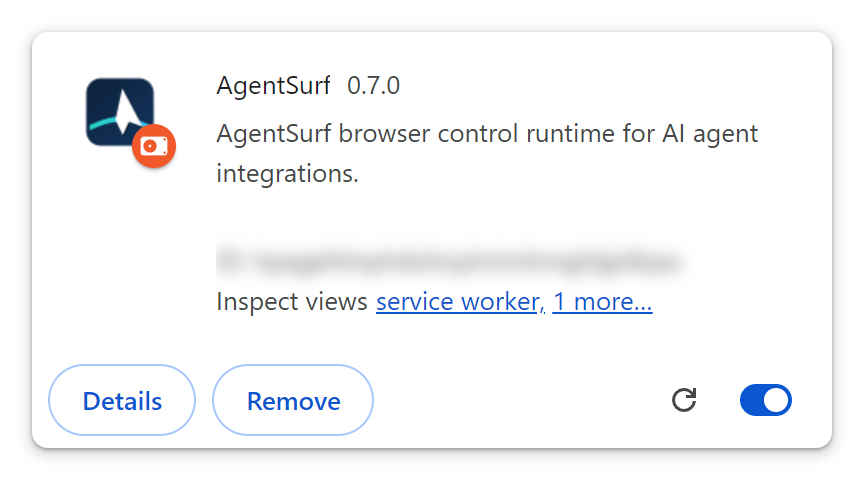
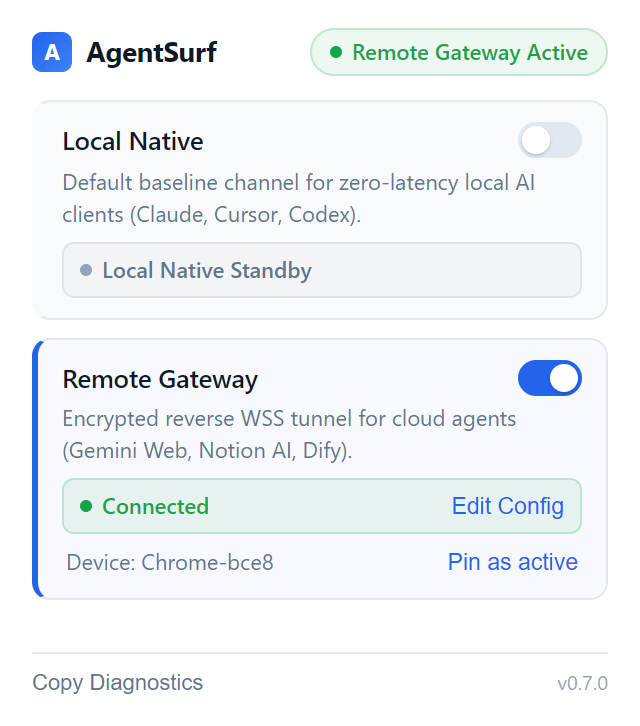
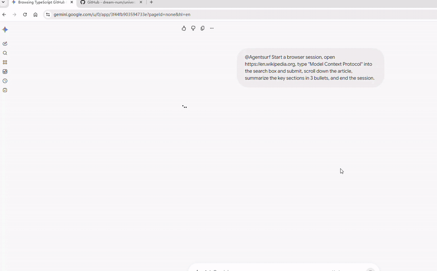

# AgentSurf

[](LICENSE)
[](package.json)
[](https://modelcontextprotocol.io/)
[](docs/remote-gateway.en.md)
[](manifest.json)

**English** | [简体中文](README.zh-CN.md)

**Give any AI agent — local or cloud — safe control over the Chrome or Edge browser you are already signed into.**

AgentSurf connects **Claude Desktop, Cursor, Codex, Gemini Web, Notion AI, Dify**, and any MCP-compatible agent to your real desktop browser. It reuses your existing logins and open tabs without launching headless browsers, exporting cookies, or triggering bot-detection walls.



---

## Why AgentSurf?

If you are choosing between **Playwright / Puppeteer MCP**, local shell browser skills like **Tencent BrowserSkill (`bsk`)**, and **AgentSurf**, here is why users pick AgentSurf:

- **Works with Cloud & Web AI — Not Just Local Terminals**: Local CLI skills (like `BrowserSkill`) require an agent with local bash/shell access, and Playwright MCP launches isolated local sandboxes. AgentSurf exposes **standard MCP (`stdio` + `Streamable HTTP`) with built-in OAuth 2.0 (PKCE)** so **Gemini Web, Notion AI, Dify**, and mobile/cloud workflows can drive your real desktop browser with zero local shell permission required.
- **Home + Office Multi-PC on One Gateway**: Instead of one daemon bound to one machine, both your home and office browsers connect to the same `wss://.../ws` endpoint without kicking each other offline—automatically routing to whichever Chrome window you are actively using.
- **No Shell Execution Risk & Built for Token Efficiency**: Unlike CLI-driven browser skills, your agent never needs shell access to control the browser. Interactive snapshots are filtered and capped *inside the page* before crossing the wire—on a reference 665-element app page (245 KB raw JSON), the default 150-element cap cuts output from **~66,800 to ~15,100 tokens**, and filtering hidden UI (`visible_only: true`) or querying by `tag` / `role` / `name_contains` shrinks it further depending on visible page density.
- **Self-Hosted Privacy & Zero Lock-In**: No third-party cloud relay, no telemetry, and no account required. Run 100% offline locally or self-host the single-file `standalone-gateway.js` (`read-only` by default on remote, hashed tokens, SHA-256 operation idempotency journal, and zero `MAIN`-world `console` patching).

| Capability | AgentSurf | Local Shell Browser Skills (e.g. Tencent BrowserSkill) | Headless MCP (Playwright / Puppeteer) |
| --- | --- | --- | --- |
| **Reuses signed-in Chrome / Edge** | Yes (live tabs & cookies) | Yes (live browser via extension) | No (starts fresh or needs brittle profile copies) |
| **Anti-bot friendliness** | Real desktop browser session | Real desktop browser session | Often flagged by headless automation signals |
| **Agent protocol** | **Standard MCP (`stdio` + `Streamable HTTP`)** — no shell required | Local **CLI (`bsk`)** — requires shell-capable coding agent | Local `stdio` / local server MCP |
| **Cloud Web Agents (Gemini Web, Notion AI, Dify)** | **Built-in OAuth 2.0 (PKCE) + Bearer + Reverse WSS** | Local shell agents only | Local only unless custom-wrapped |
| **Home + Office multi-PC routing** | **Yes** — active-window auto-routing, session stickiness & pinning | Single local machine daemon | Single local process |
| **Context & token footprint** | In-page filtering (`visible_only`, `tag`, `role`, `name_contains`) + 150-element cap | Page extraction via CLI commands | Large raw DOM / AX tree dumps |
| **Safety & isolation** | Remote `read-only` default, per-session Tab Groups, `operation_unknown` idempotency, zero `MAIN`-world patching | Dedicated agent window / tab borrowing + human confirmation | Shared browser state; full read/write by default |

---

## Key Features

- **Dual-Channel Transport**:
  - **Local Native (`stdio`)**: Zero network dependencies, ultra-low latency via Chrome Native Messaging + loopback bridge (`127.0.0.1:8765`).
  - **Cloud Remote Gateway (`Streamable HTTP` + `Reverse WSS`)**: Deploy a single self-contained `standalone-gateway.js` on any VPS. Your local browser initiates an outbound encrypted WebSocket connection—no port forwarding, SSH tunnels, or public IP needed on your PC.
- **Full OAuth 2.0 + PKCE & Bearer Token Support**:
  - Implements MCP OAuth discovery (`/.well-known/oauth-protected-resource`, `/.well-known/oauth-authorization-server`), `Client ID` / `Client Secret`, `S256` PKCE, consent UI, and refresh tokens—ready for **Gemini Web**.
  - Also supports static **Bearer Token** headers for **Notion AI**, **Dify**, and custom HTTP MCP agents.
- **Port-Agnostic Public Routing**:
  - Host, Origin, and OAuth metadata adapt dynamically to the incoming request `Host` and `X-Forwarded-Proto`, so one gateway config works across standard port `443` or any alternate reverse-proxy port.
- **Multi-Computer Coexistence (Home + Office)**:
  - Connect multiple computers (e.g., `Home` and `Office`) to the same `wss://.../ws` endpoint without kicking each other offline.
  - Routes automatically to whichever Chrome window you actively focused/used most recently, locks active sessions to their originating computer, and supports pinning in the extension popup or explicit `device` targeting.
- **29 Browser Control Tools (Token-Efficient by Design)**:
  - Semantic interactive element snapshots (`browser_get_interactives` with opaque `element_id`s, in-page filtering by `tag` / `role` / `name_contains` / `visible_only`, and default `150` cap—trimming a 245 KB / 665-element raw snapshot to 150 elements by default, and much smaller when scoped to visible or matching controls).
  - Page content extraction, click/double-click/type/press/select/checkbox/drag/scroll, viewport & full-page screenshots, iframe navigation, JS dialog handling, downloads, and file uploads (`DOM.setFileInputFiles`).

---

## Architecture



---

## Quick Start

### Prerequisites

| Requirement | Version & Check |
| --- | --- |
| **Node.js** | `20+` (`node -v`) |
| **Git** | `git --version` |
| **Chrome or Edge** | `116+` (`chrome://version` / `edge://version`) |

> No administrator privileges required. Your existing browser profiles, passwords, and settings are never modified.

---

### Path A: Local Deployment (Claude Desktop, Cursor, Codex, etc.)

1. **Clone and run the setup wizard**:

   ```bash
   git clone https://github.com/ztao0916/agentsurf-browser-control-runtime.git
   cd agentsurf-browser-control-runtime
   npm run setup
   ```

   To configure **both** Chrome and Edge simultaneously (with separate ports and configs):

   ```bash
   npm run setup -- --browser all
   ```

2. **Load the extension in Chrome / Edge**:
   - Open `chrome://extensions` (or `edge://extensions`) and enable **Developer mode**.
   - Click **Load unpacked** and select the project's `dist/` folder.
   - Copy the generated **Extension ID** from the AgentSurf card and paste it into the terminal prompt.

   

3. **Reload & verify the extension popup**:
   - Click **Reload** on the AgentSurf extension card, then click the AgentSurf toolbar icon and verify **Local Native** is active.

   

4. **Add the printed MCP config to your agent**:

   ```json
   {
     "mcpServers": {
       "agentsurf": {
         "command": "<absolute launcher path printed by setup>"
       }
     }
   }
   ```

   When installed with `--browser all`, `setup` prints separate `agentsurf-chrome` and `agentsurf-edge` entries so you can target either browser cleanly.

---

### Path B: Remote Cloud Gateway (Gemini Web, Notion AI, Dify, Remote Agents)

Use Remote Gateway mode when your AI runs in the cloud and needs to control your local browser over HTTPS/WSS.

1. Build the single-file gateway locally (`npm run build` produces `dist/mcp/standalone-gateway.js` with zero `node_modules` needed on the server).
2. Upload `dist/mcp/standalone-gateway.js` to your server behind Caddy/Nginx HTTPS, initialize credentials (`init-remote --url https://mcp.example.com`), and start it with PM2 (`start-remote`).
3. Pair your Chrome/Edge extension in the popup under **Remote Gateway** using your `wss://.../ws` URL, Pairing Token, and an optional **Device Name** (e.g., `Home` / `Office`).
4. Connect your cloud client:
   - **Gemini Web**: Use the generated `OAuth Client ID` and `OAuth Client Secret`, register Gemini's Redirect URI with `add-oauth-redirect --uri "..."`, and approve the browser prompt with your Pairing Token.
   - **Notion AI / Dify / Custom HTTP MCP**: Use `https://mcp.example.com/mcp` with `Authorization: Bearer <token>`.



👉 **Full step-by-step instructions**: **[Remote Gateway & OAuth 2.0 Guide (docs/remote-gateway.en.md)](docs/remote-gateway.en.md)**

---

## Multi-Browser & Multi-Computer Routing

### Multiple browsers on one PC (Chrome + Edge)
Each MCP server entry (`agentsurf` / `agentsurf-chrome` vs `agentsurf-edge`) runs its own isolated bridge, tab leases, and sessions. Do not pass a Chrome `tab_id` or `element_id` to the Edge server.

### Multiple PCs on one Cloud Gateway (Home + Office)
1. Connect both browsers to the same `wss://mcp.example.com/ws` URL with the same Pairing Token and distinct **Device Names** (e.g., `Home`, `Office`).
2. **Automatic active routing**: The gateway defaults to whichever computer's Chrome window was most recently focused or used by you—idle/background browsers reconnecting will not steal control.
3. **Session stickiness**: Once `browser_start_session` starts on a computer, every step of that task stays pinned to that same computer until completion.
4. **Manual control when needed**: Click **Pin as active** in the extension popup to lock a browser, pass `device: "Office"` to `browser_start_session`, or connect via `https://mcp.example.com/mcp?device=Home`.

---

## Use and verify

Ask your connected agent:

```text
Open https://example.com and tell me the page title.
```

> Seeing *"Chrome is being debugged"* during screenshots or file uploads is normal Chrome CDP behavior.

### Safety Recommendations

- **Start in `read-only` mode** when deploying the remote gateway (`init-remote` defaults to `read-only`; explicitly switch to `interactive` only when ready).
- **Keep human confirmation** before consequential actions such as submitting forms, making purchases, deleting records, uploading files, or sending messages.
- **Never share secrets** (passwords, OTPs, cookies, or pairing tokens) inside prompts, and never commit local `config.json` or `remote-config.json` files.

---

## Documentation & Links

- **[Remote Gateway Deployment & OAuth 2.0 Guide](docs/remote-gateway.en.md)** ([中文版](docs/remote-gateway.md))
- **[Developer & Protocol Reference](docs/reference.en.md)** ([中文版](docs/reference.md))
- **[Security Policy](SECURITY.md)**
- **[Contributing](CONTRIBUTING.md)**
- **[Changelog](CHANGELOG.md)**

Licensed under the [Apache License 2.0](LICENSE).
