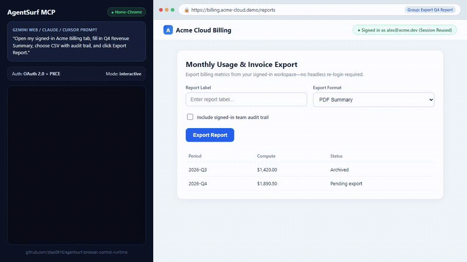
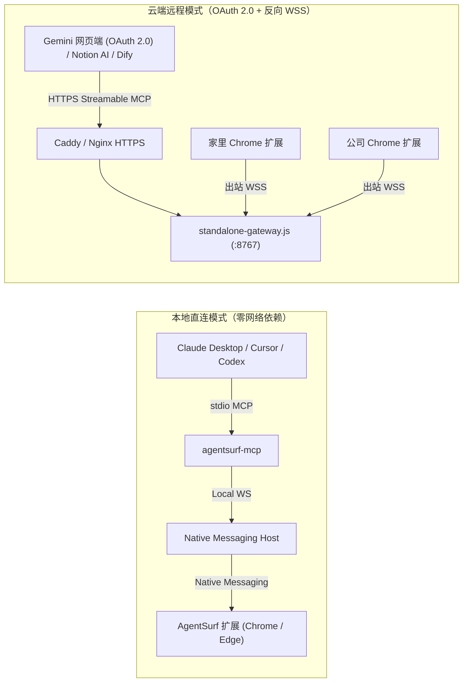
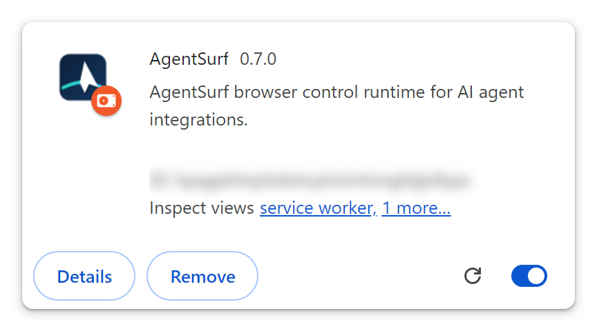
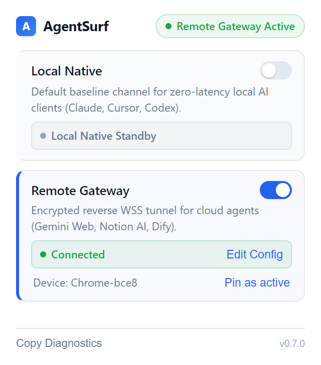
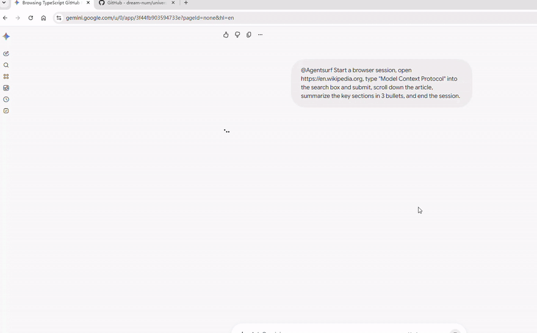

# AgentSurf

[](LICENSE)
[](package.json)
[](https://modelcontextprotocol.io/)
[](docs/remote-gateway.md)
[](manifest.json)

[English](README.md) | **简体中文**

**让任何本地或云端 AI Agent 安全操控你当前已登录的 Chrome / Edge 浏览器。**

AgentSurf 可以接入 **Claude Desktop、Cursor、Codex、Gemini 网页端、Notion AI、Dify** 等任意支持 MCP 的智能体。它直接复用你本机现有的登录态和标签页，无需启动无头浏览器、无需导出 Cookie，也无需重复登录。



---

## 为什么选择 AgentSurf？

如果你在对比 **Playwright / Puppeteer MCP**、**腾讯 BrowserSkill (`bsk`)** 等大厂本地浏览器 Skill 与 **AgentSurf**，下面这些差异正是开发者选择 AgentSurf 的核心原因：

- **不仅能本地用，更能从云端 / 网页端 AI 直接操控**：`BrowserSkill` 主打本地 Shell 命令行（`bsk`），要求 Agent 必须有本机终端权限；Playwright MCP 默认起本地隔离沙盒。**AgentSurf 原生实现标准 MCP（`stdio` + `Streamable HTTP`）与 OAuth 2.0 (PKCE)**，让 **Gemini 网页端、Notion AI、Dify** 等没有本地终端的云端/网页智能体，也能安全调度你桌面上的真实 Chrome / Edge。
- **家里 + 公司跨电脑协同，一个网关搞定**：大厂本地 CLI 工具通常绑定单台机器的守护进程；AgentSurf 允许家里和公司浏览器同时挂在同一个 `wss://.../ws` 地址下而不互踢，并按当前活跃操作窗口自动路由。
- **无需开放 Shell 权限，且为大模型省 Token 而设计**：Agent 调用的是带严格 Schema 校验的 MCP 工具，无需给它本机 Bash/Shell 权限；交互快照直接在页面内完成过滤与截断后再回传——在某 665 元素重型页面（245 KB 原始 JSON）的参考测量中，默认 150 上限即可将输出从 **~66,800 降至 ~15,100 tokens**，配合 `visible_only: true` 或 `tag` / `role` / `name_contains` 过滤隐藏面板后可进一步大幅缩减。
- **私有自托管、零厂商绑定与安全护栏**：无第三方云端中转、无遥测、无需注册账号。支持完全离线本地运行或单文件 `standalone-gateway.js` 自建网关（远程默认 `read-only` 只读、Token/Secret 全量哈希、SHA-256 操作幂等防重放、不向页面 `MAIN` 世界注入 `console` 劫持）。

| 对比维度 | AgentSurf | 本地 CLI 浏览器 Skill（如腾讯 BrowserSkill） | 无头浏览器 MCP（Playwright / Puppeteer） |
| --- | --- | --- | --- |
| **复用已登录 Chrome / Edge** | 支持（复用真实标签页与 Cookie） | 支持（通过扩展复用真实浏览器） | 不支持（默认空白环境或需搬运 Profile） |
| **反爬与风控友好度** | 真实桌面浏览器环境 | 真实桌面浏览器环境 | 容易被无头自动化特征识别拦截 |
| **接入协议与权限面** | **标准 MCP（`stdio` + `Streamable HTTP`）**，无需给 Agent 开 Shell | 主打本地 **CLI（`bsk`）**，依赖具备本地 Shell 权限的 Agent | 本地 `stdio` / 本地 MCP Server |
| **云端网页 Agent（Gemini 网页端 / Notion AI / Dify）** | **内置 OAuth 2.0 (PKCE) + Bearer + 反向 WSS** | 仅限本地有终端的编程 Agent | 仅限本地，除非自行封装暴露 |
| **家里 + 公司多电脑路由** | **支持**（同网关不互踢、活跃窗口自动路由、会话锁定） | 单机本地守护进程 | 单机本地进程 |
| **上下文与 Token 消耗** | 页面内过滤（`visible_only` / `tag` / `role` / `name_contains`）+ 默认 150 上限 | 通过 CLI 命令抽取内容 | 易输出整棵大 DOM / AX 树 |
| **安全与隔离机制** | 远程默认 `read-only`、会话级 Tab Group 隔离、`operation_unknown` 幂等保护、无 `MAIN` 世界注入 | 独立 Agent 窗口 / 借用归还 + 人工确认 | 共享状态、默认全量读写权限 |

---

## 核心特性

- **双通道架构**：
  - **本地直连（`stdio`）**：零网络依赖，通过 Chrome Native Messaging + 本机回环 Bridge（`127.0.0.1:8765`）低延迟运行。
  - **云端远程网关（`Streamable HTTP` + `反向 WSS`）**：云服务器部署单文件 `standalone-gateway.js`，由本机扩展主动向外建立加密 WebSocket 长连接，本地电脑无需公网 IP、无需 SSH 隧道或终端常驻。
- **完整支持 OAuth 2.0 (PKCE) 与静态 Bearer Token**：
  - 实现标准 MCP OAuth 发现端点（`/.well-known/oauth-protected-resource`、`/.well-known/oauth-authorization-server`）、`Client ID` / `Client Secret`、`S256` PKCE、授权确认页及 `refresh_token`，可直接接入 **Gemini 网页端**。
  - 同时兼容静态 **Bearer Token**，无缝对接 **Notion AI**、**Dify**、Coze 及自建 HTTP MCP 客户端。
- **公网端口解绑**：
  - 对非回环公网域名不再强绑定配置时的端口号，并按请求 `Host` 与 `X-Forwarded-Proto` 动态生成 OAuth 元数据，同一份配置可兼容 443 默认端口或任意备用反代端口。
- **多电脑共存与活跃路由（家里 + 公司）**：
  - 多台电脑可同时连接同一个 `wss://.../ws` 地址而不互踢；扩展支持自定义设备名称（如 `家里`、`公司`）。
  - 平时自动跟随你最近一次操作聚焦的浏览器，会话期间严格锁定发起设备；也支持在扩展面板一键「设为当前主控」，或在 `browser_start_session` 传 `device` 参数 / URL `?device=` 显式指定。
- **29 个浏览器控制工具**：
  - 语义化交互元素快照（不透明 `element_id`、页面内过滤与数量上限控制）、正文抽取、点击/双击/输入/按键/下拉/勾选/拖拽/滚动、可视区域与整页截图、iframe 切换、弹窗处理、下载管理及文件上传（`DOM.setFileInputFiles`）。

---

## 架构概览



---

## 快速开始

### 环境准备

| 需要 | 要求与检查方式 |
| --- | --- |
| **Node.js** | `20+`（`node -v`） |
| **Git** | `git --version` |
| **Chrome 或 Edge** | `116+`（`chrome://version` / `edge://version`） |

> 不需要管理员权限，也不会修改你 Chrome 里已有的登录态和设置。

---

### 方式 A：本地部署（Claude Desktop、Cursor、Codex 等本机 Agent）

1. **克隆仓库并运行安装向导**：

   ```bash
   git clone https://github.com/ztao0916/agentsurf-browser-control-runtime.git
   cd agentsurf-browser-control-runtime
   npm run setup
   ```

   如需同时安装 Chrome 和 Edge（各自独立端口与配置）：

   ```bash
   npm run setup -- --browser all
   ```

2. **在浏览器加载扩展**：
   - 打开 `chrome://extensions`（或 `edge://extensions`），开启**开发者模式**。
   - 点击**加载已解压的扩展程序**，选择项目根目录下的 `dist/`。
   - 复制 AgentSurf 卡片上的 **ID**，粘贴回终端完成 Native Host 注册。

   

3. **重载扩展并检查连接状态**：
   - 回到扩展管理页点击 AgentSurf 卡片上的 **重新加载**，点击工具栏 AgentSurf 图标确认 **「本地直连」** 处于生效状态。

   

4. **将终端输出的 MCP 配置加入你的 Agent**：

   ```json
   {
     "mcpServers": {
       "agentsurf": {
         "command": "<setup 输出的启动器绝对路径>"
       }
     }
   }
   ```

   使用 `--browser all` 时会同时输出 `agentsurf-chrome` 和 `agentsurf-edge`，可按需分别调用 Chrome 或 Edge。

---

### 方式 B：云端远程网关（Gemini 网页端、Notion AI、Dify 等）

当你希望云端 SaaS 或网页版 AI 智能体跨网络调度本地浏览器时使用远程网关模式：

1. 本地执行 `npm run build`，生成零依赖单文件 `dist/mcp/standalone-gateway.js`。
2. 上传到带 HTTPS 反代（Caddy / Nginx）的云服务器，运行 `init-remote --url https://mcp.example.com` 初始化配置（同时生成 Bearer Token 与 OAuth Client ID/Secret），并用 PM2 后台运行 `start-remote`。
3. 在本地和公司浏览器的 AgentSurf 扩展面板切换到 **「云端网关」**，填入 `wss://.../ws`、配对密钥及可选的 **本机设备名称**（如 `家里`、`公司`）。
4. 接入云端客户端：
   - **Gemini 网页端**：填入 `OAuth Client ID` 与 `OAuth Client Secret`，用 `add-oauth-redirect --uri "..."` 将 Gemini 的重定向 URI 加入白名单，授权时输入配对密钥确认即可。
   - **Notion AI / Dify / 自定义 HTTP MCP**：填入 `https://mcp.example.com/mcp` 与 `Authorization: Bearer <配对密钥>`。



> **关于 Gemini 网页端连续授权提示的说明**：为保证演示紧凑，上方 GIF 已剪去等待连接与权限确认弹窗。AgentSurf 已为只读检查工具标记 MCP `readOnlyHint: true`（Gemini 会将其分到 **只读** 分组并自动放行），但受 **Gemini 网页端客户端对第三方 MCP 的安全策略限制**，在调用交互/写入类工具（如 `browser_start_session`、`browser_open`、`browser_type`、`browser_click`、`browser_scroll`、`browser_end_session`）时，**即使已在「应用操作 / App actions」里将「写入/删除」设为 `始终允许 / Always allow`，对话中仍会弹出 `Always allow` 确认卡片**，需要手动点击放行（该行为由 Gemini 网页端控制，非扩展或网关限制）。

👉 **完整部署与 OAuth 接入步骤请参阅**：**[云端远程网关部署与多环境接入指南 (docs/remote-gateway.md)](docs/remote-gateway.md)**

---

## 多浏览器与多电脑协同

### 同机多浏览器（Chrome + Edge）
`agentsurf` / `agentsurf-chrome` 操作 Chrome，`agentsurf-edge` 操作 Edge，各自拥有独立的标签页租约和会话，不要混传 `tab_id` 或 `element_id`。

### 跨电脑协同（家里 + 公司共用同一云端网关）
1. 两台电脑的扩展都连同一个 `wss://mcp.example.com/ws` 地址和配对密钥，并分别设置设备名（如 `家里`、`公司`）。
2. **自动跟随**：网关默认路由到最近一次由你聚焦/切换标签页的在线浏览器；后台闲置电脑重连不会抢夺控制权。
3. **会话粘性**：`browser_start_session` 一旦在某台设备创建，后续该会话的所有操作均绑定该设备，不会中途漂移。
4. **手动锁定 / 点名**：可在扩展面板点击「设为当前主控」锁定本机，或在 `browser_start_session` 传入 `device` 参数 / 使用 `https://mcp.example.com/mcp?device=家里`。

---

## 使用与检查

在对话里直接对 Agent 说：

```text
打开 https://example.com，告诉我页面标题。
```

> 截图或上传文件时浏览器顶部出现“Chrome 正在被调试”属于正常 CDP 行为。

### 安全建议

- 远程网关初始化后默认为 **`read-only` 只读模式**，确认需要交互操作后再手动开启 `interactive`。
- 提交表单、购买支付、删除数据、上传文件、发送消息等高风险动作前，请先确认再执行。
- 切勿把密码、验证码、Cookie 或配对密钥发给 Agent，也不要把本机 `config.json` / `remote-config.json` 提交到代码仓库。

---

## 相关文档

- **[云端远程网关部署与多环境接入指南](docs/remote-gateway.md)**（[English](docs/remote-gateway.en.md)）
- **[开发者与协议参考文档](docs/reference.md)**（[English](docs/reference.en.md)）
- **[安全策略](SECURITY.md)**
- **[贡献指南](CONTRIBUTING.md)**
- **[更新日志](CHANGELOG.md)**

本项目采用 [Apache License 2.0](LICENSE)。
