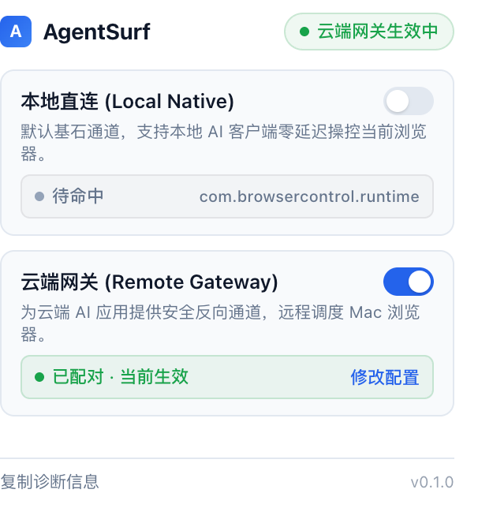

# AgentSurf 远程网关与 Notion AI 连接指南

本指南介绍如何将 **AgentSurf** 部署为云端网关，让 **Notion AI**（及任何云端 AI Agent）能够安全、稳定地控制您本地电脑上的真实 Chrome / Edge 浏览器。

本项目采用轻量高效的反向连接架构：
* **云端服务器**：常驻运行轻量网关（由 Caddy 提供 HTTPS / WSS），Notion 永久在线连接。
* **本地电脑**：**0 命令行、0 终端常驻、0 SSH 隧道**！只需在 Chrome 扩展弹窗中填入一次服务器地址，扩展在后台自动与云端建立长连接配对。

---

## 🤖 偷懒省心：直接交给 AI Agent 自动部署

如果你正在使用能操作电脑终端或服务器的 AI Agent（如 Claude Code、Cursor、Codex、Windsurf 等），你完全不需要手动执行下面的步骤，直接将以下提示词发给 AI：

> **📋 复制发给 AI 的指令：**
> 
> ```text
> 请阅读本项目中的 docs/notion-mcp.md，帮我完成 AgentSurf 云端网关的构建与部署：
> 1. 我的云服务器 IP 是：[填写你的服务器IP]，SSH 账号是：root（已配置密钥或请提示我输入密码）；
> 2. 我的域名是：[填写你的域名，例如 mcp.example.com]（已解析到该服务器 IP）；
> 3. 请帮我在本地执行 npm run build 编译最新的 standalone-gateway.js，并上传部署到云服务器常驻运行；
> 4. 在云服务器上配置好 Caddy 反向代理（如 443 被占用请使用 9443 备用端口）；
> 5. 部署完成后，请直接告诉我：
>    - Notion 中填写的 Server URL 和 Bearer Token
>    - Chrome 扩展中填写的 Gateway WSS URL 和 Token
> ```

AI Agent 会自动替你完成依赖打包、服务器配置和后台常驻。你只需要在 Chrome 扩展和 Notion 里填入最终密钥即可！

---

## 一、 架构与工作原理

```
[ Notion AI (云端) ]
        │  HTTPS 请求 (带 Bearer Token)
        ▼
[ 你的云服务器 (Caddy :9443 / :443) ]
        │  本地反向代理转发
        ▼
[ 云端网关 (standalone-gateway.js :8767) ]
        ▲
        │  WSS 加密长连接配对 (wss://mcp.example.com:9443/ws)
        │  (浏览器主动发起，本地 0 终端、无需公网 IP)
[ 本地 Mac / PC Chrome (AgentSurf 扩展) ]
        │
        ▼
[ 本地真实打开并登录的网页 (执行点击/输入/截图/提取) ]
```

---

## 二、 云服务器部署步骤（手动配置）

### 1. 准备条件
* 一台 Linux 云服务器（推荐 Ubuntu / Debian）。
* 一个解析到该服务器公网 IP 的域名（如 `mcp.example.com`）。
* 在云服务器控制台安全组（防火墙）中放行所用端口（例如：**80** 用于自动签发证书，**9443** 或 **443** 用于 HTTPS/WSS 访问）。

---

### 2. 安装并配置 Caddy 反向代理

Caddy 会自动申请并自动续期 Let's Encrypt 合法 HTTPS 证书，并原生支持 WebSocket 转发。

#### 安装 Caddy (以 Debian/Ubuntu 为例)
```bash
sudo apt install -y debian-keyring debian-archive-keyring apt-transport-https curl
curl -1sLf 'https://dl.cloudsmith.io/public/caddy/stable/gpg.key' | sudo gpg --dearmor -o /usr/share/keyrings/caddy-stable-archive-keyring.gpg
curl -1sLf 'https://dl.cloudsmith.io/public/caddy/stable/debian.deb.txt' | sudo tee /etc/apt/sources.list.d/caddy-stable.list
sudo apt update
sudo apt install caddy -y
```

#### 配置 Caddyfile
将下面命令中的域名和端口替换为你的真实配置（如果 443 端口被 Xray/V2Ray 占用，可使用 `9443`）：

```bash
sudo tee /etc/caddy/Caddyfile << 'EOF'
mcp.example.com:9443 {
    reverse_proxy 127.0.0.1:8767
}
EOF

sudo systemctl restart caddy
sudo systemctl enable caddy
```

---

### 3. 上传并运行单文件网关 (`standalone-gateway.js`)

项目已打包成包含所有依赖的单文件，无需在服务器上安装繁重的 `node_modules`。

#### A. 在本地 Mac 终端上传网关文件
在项目根目录下执行：
```bash
scp dist/mcp/standalone-gateway.js root@你的服务器IP:/root/
```

#### B. 登录云服务器，初始化并常驻启动
```bash
# 确保安装了 Node.js (>= 18)
# 如未安装：curl -fsSL https://deb.nodesource.com/setup_20.x | bash - && apt-get install -y nodejs

# 1. 初始化配置与密钥（把域名换成你真实的公网地址）
node /root/standalone-gateway.js init-remote --url https://mcp.example.com:9443

# 终端会打印出配对密钥（Bearer Token），请复制保存！

# 2. 启动网关并在后台常驻运行
pkill -f standalone-gateway
nohup node /root/standalone-gateway.js start-remote > /root/gateway.log 2>&1 &
```

#### C. 验证云端状态
在任意终端测试健康检查端点：
```bash
curl https://mcp.example.com:9443/health
```
返回 `{"status":"ok","service":"agentsurf-remote","extension_connected":false}` 即表示云端网关完全就绪！

---

## 三、 本地 Chrome 浏览器配对（0 命令行）

你**本地电脑完全不需要运行任何命令，也不需要开 SSH 隧道**：

1. 打开 Chrome 扩展管理 `chrome://extensions`，找到 **AgentSurf**，点击卡片右下角的 **🔄 刷新**。
2. 点击 Chrome 右上角工具栏中的 **AgentSurf** 图标打开面板：
   * 顶部点击切换到 **【远程配对 (Remote)】** 选项卡；
   * **云端网关地址 (Gateway WSS URL)**：输入 `wss://mcp.example.com:9443/ws`
   * **配对密钥 (Bearer Token)**：粘贴服务器初始化时生成的密钥；
   * 点击 **【保存并连接 (Connect)】**。
3. 状态圆点即刻变为绿色的 **`● connected`**！

*(此时若再次访问 `https://mcp.example.com:9443/health`，会看到 `"extension_connected": true`)*

---

## 四、 在 Notion AI 中配置连接

1. 打开 **Notion**，进入 **设置 (Settings)** -> **连接 (Connections)**（或在自定义智能体设置里找到 **MCP 连接**）。
2. 点击 **添加 MCP 连接 (Add connection)**：
   * **名称 (Name)**：`AgentSurf`
   * **URL / 端点**：`https://mcp.example.com:9443/mcp`
   * **认证类型 (Authentication)**：选择 `Bearer Token`
   * **Token / 凭证**：粘贴刚才的配对密钥
3. 点击 **保存 (Save)**。

---

## 五、 如何在 Notion 中使用

配置完成后，在 Notion 中直接以自然语言提问：

* **总结热点资讯**：
  > “帮我用 AgentSurf 打开 https://news.ycombinator.com ，看看排名前 3 的新闻是什么并写到当前页面。”
* **操作网页并截图**：
  > “帮我打开携程网页，查一下明天北京飞上海的最早航班，把页面截图发给我。”
* **读取当前已有标签页**：
  > “看一下我电脑 Chrome 里现在打开了哪些标签页，帮我整理它们的内容。”

你电脑屏幕上的 Chrome 会即刻自动执行页面操作，并将结果无缝回传给 Notion！

---

## 六、 本地直连与云端网关自由切换

AgentSurf 采用双通道互斥开关设计，单面板即可自由切换：

* **本地直连 (Local Native)**：
  * 专供本地客户端使用（如 Claude Desktop、Cursor、Codex 等）；
  * **零网络依赖，断网可用**，走本地 Native Messaging 回环管道，延迟极低；
  * 切换方法：开启卡片上的 **【本地直连】** 开关，云端网关自动变灰待命。
* **云端网关 (Remote Gateway)**：
  * 专供 Notion AI 等云端客户端跨设备使用；
  * 本地电脑只要开着 Chrome，云端 Notion 随时可以通过反向通道调度当前浏览器；
  * 切换方法：开启卡片上的 **【云端网关】** 开关，本地通道自动待命。



---

## 七、 常见问题与排查 (FAQ)

### 1. 扩展提示 `Connection closed (code 1006)`
* **原因**：填写的 Token 与服务器保存的 Token 不一致，导致服务器鉴权失败关闭了连接。
* **解决办法**：
  1. 在云服务器上删除旧配置：
     ```bash
     rm -f /root/AppData/Local/BrowserControlRuntime/remote-config.json
     ```
  2. 重新生成配置并重启：
     ```bash
     node /root/standalone-gateway.js init-remote --url https://mcp.example.com:9443
     pkill -f standalone-gateway
     nohup node /root/standalone-gateway.js start-remote > /root/gateway.log 2>&1 &
     ```
  3. 将新生成的 Token 复制并重新粘贴到 Chrome 扩展中点击连接。

### 2. 服务器 443 端口被代理服务（如 Xray / V2Ray）占用
* **解决办法**：不要关闭你的代理服务。只需让 Caddy 监听备用端口（例如 `9443` 或 `8443`），并在云服务器安全组放行该端口。Caddy 依然可以通过 80 端口自动申请合法的 SSL 证书。
