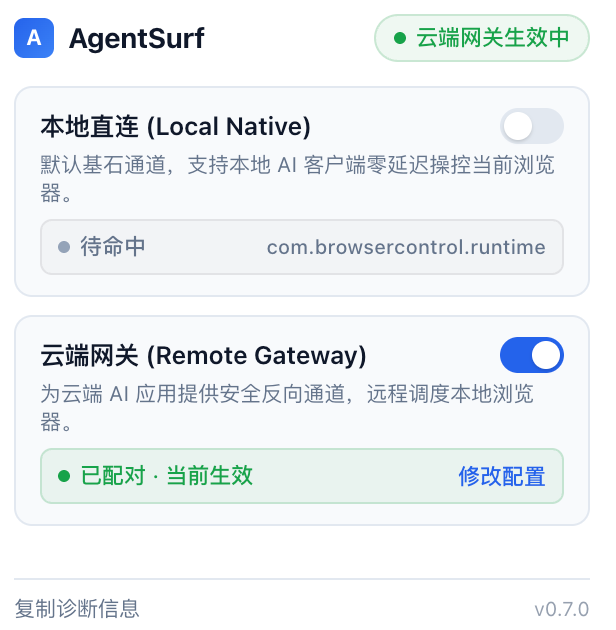

# AgentSurf 云端远程网关部署与多环境接入指南

本指南介绍如何将 **AgentSurf** 部署为通用的云端远程网关。通过该网关，运行在云端服务器、SaaS 平台或私有云环境中的各类 AI 智能体（如自建云端 Agent、Dify、Coze、FastGPT、Notion AI、自动化流等），均可安全、稳定、跨网络地调度您本地电脑上的真实 Chrome / Edge 浏览器。

本项目采用轻量高效的反向连接网关架构：
* **云端服务器**：常驻运行轻量网关（由 Caddy 提供 HTTPS / WSS），对外暴露标准 HTTP MCP 接口，供任意云端 Agent 调用。
* **本地电脑**：**0 命令行、0 终端常驻、0 SSH 隧道、无需公网 IP**！只需在 Chrome 扩展面板一键填入网关地址，扩展在后台自动建立长连接配对。

---

## 🤖 偷懒省心：直接交给 AI Agent 自动部署

如果你正在使用能操作电脑终端或服务器的 AI 编程工具（如 Claude Code、Cursor、Codex、Windsurf 等），你完全不需要手动执行繁琐命令，直接将以下提示词发给 AI：

> **📋 复制发给 AI 的指令：**
> 
> ```text
> 请阅读本项目中的 docs/remote-gateway.md，帮我完成 AgentSurf 云端远程网关的构建与部署：
> 1. 我的云服务器 IP 是：[填写你的服务器IP]，SSH 账号是：root（已配置密钥或请提示我输入密码）；
> 2. 我的域名是：[填写你的域名，例如 mcp.example.com]（已解析到该服务器 IP）；
> 3. 请帮我在本地执行 npm run build 编译最新的 standalone-gateway.js，并上传到云服务器；在服务器上使用 PM2 后台运行并配置开机恢复；
> 4. 在云服务器上配置好 Caddy 反向代理（如 443 被占用请使用 9443 备用端口）；
> 5. 部署完成后，请直接告诉我：
>    - 云端 MCP 客户端（如 Notion AI / 自定义 Agent）中填写的 Server URL 和 Bearer Token
>    - Chrome 扩展中填写的 Gateway WSS URL 和 Token
> ```

AI Agent 会自动替你完成依赖打包、服务器配置和 PM2 进程管理。部署完成后，你只需要在 Chrome 扩展和云端 Agent 里填入配对密钥即可！

---

## 一、 架构与工作原理

```
[ 云端 AI Agent / 远程 MCP 客户端 ]
(自定义云端智能体 / Dify / Coze / Notion AI 等)
        │  HTTPS 请求 (标准 Streamed HTTP MCP 协议)
        ▼
[ 你的云服务器 (Caddy :9443 / :443) ]
        │  本地反向代理转发
        ▼
[ 云端网关 (standalone-gateway.js :8767) ]
        ▲
        │  WSS 加密反向长连接
        │  (本地浏览器主动发起，免公网 IP，跨网络穿透)
[ 本地 Mac / PC Chrome (AgentSurf 扩展) ]
        │
        ▼
[ 本地真实打开并登录的网页 (执行点击 / 输入 / 提取 / 截图) ]
```

---

## 二、 云服务器部署步骤（手动配置）

### 1. 准备条件
* 一台 Linux 云服务器（推荐 Ubuntu / Debian）。
* 一个解析到该服务器公网 IP 的域名（如 `mcp.example.com`）。
* 在云服务器控制台安全组（防火墙）中放行所用端口（例如：**80** 用于自动签发证书，**9443** 或 **443** 用于 HTTPS/WSS 访问）。

---

### 2. 安装并配置 Caddy 反向代理

Caddy 会自动申请并自动续期 Let's Encrypt 合法 HTTPS 证书，并原生支持 WebSocket 转发。

#### 安装 Caddy (以 Debian/Ubuntu 为例)
```bash
sudo apt install -y debian-keyring debian-archive-keyring apt-transport-https curl
curl -1sLf 'https://dl.cloudsmith.io/public/caddy/stable/gpg.key' | sudo gpg --dearmor -o /usr/share/keyrings/caddy-stable-archive-keyring.gpg
curl -1sLf 'https://dl.cloudsmith.io/public/caddy/stable/debian.deb.txt' | sudo tee /etc/apt/sources.list.d/caddy-stable.list
sudo apt update
sudo apt install -y caddy
```

#### 配置 Caddyfile
编辑 `/etc/caddy/Caddyfile`，写入以下内容（注意替换为你的真实域名）：

```caddy
# 如果 443 被其他代理服务占用，建议监听 9443
mcp.example.com:9443 {
    # 转发 MCP HTTP 与 WebSocket 到本地 8767 端口
    reverse_proxy 127.0.0.1:8767
}
```

重新加载 Caddy 配置：
```bash
sudo systemctl reload caddy
```

---

### 3. 上传并运行 AgentSurf 云端独立网关

#### A. 在本地电脑打包网关文件
在当前项目根目录下运行编译：
```bash
npm run build
```
编译成功后，在 `dist/mcp/` 目录下会生成一个完全自包含、无需安装 `node_modules` 的单文件：`dist/mcp/standalone-gateway.js`。

#### B. 上传到云服务器
```bash
scp dist/mcp/standalone-gateway.js root@<服务器IP>:/root/
```

#### C. 在云服务器上初始化配置并用 PM2 运行
登录云服务器：
```bash
ssh root@<服务器IP>

# 1. 确保云服务器已安装 Node.js (>=20)
node -v || (curl -fsSL https://deb.nodesource.com/setup_20.x | bash - && apt-get install -y nodejs)

# 2. 安装 PM2（若尚未安装）
pm2 -v || npm install -g pm2

# 3. 初始化远程配置（首次部署时运行，会生成配对 Bearer Token）
node /root/standalone-gateway.js init-remote --url https://mcp.example.com:9443

# 4. 通过 PM2 在后台启动网关
pm2 start /root/standalone-gateway.js --name agentsurf-gateway -- start-remote

# 5. 检查进程和服务器本机健康接口
pm2 status
curl -i http://127.0.0.1:8767/health
```

运行 `init-remote` 时，终端会输出以下信息。请保存 Bearer Token，后续配置 Chrome 扩展和远程 MCP 客户端时都要用到；不要重复运行 `init-remote`，除非确实要重新初始化配置。

* **Bearer Token**：自动生成的配对密钥
* **Public MCP URL**：`https://mcp.example.com:9443/mcp`
* **Gateway WS URL**：`wss://mcp.example.com:9443/ws`

健康检查应返回 `HTTP/1.1 200 OK` 和 `"status":"ok"`。完成 Chrome 扩展配对后，`extension_connected` 应为 `true`；配对前为 `false` 是正常的。

新初始化的网关默认使用 **只读权限**：可读取页面并查看标签页，但不会开放点击、输入或导航。需要网页交互时，在服务器上显式切换为交互模式，并重启 PM2 进程使 MCP 工具列表刷新：

```bash
node /root/standalone-gateway.js set-remote-access --mode interactive
pm2 restart agentsurf-gateway
```

切回只读模式：

```bash
node /root/standalone-gateway.js set-remote-access --mode read-only
pm2 restart agentsurf-gateway
```

升级前创建的配置没有权限字段，会继续沿用交互模式。可用 `node /root/standalone-gateway.js doctor` 检查配置、本机健康接口和扩展连接；追加 `--url https://mcp.example.com:9443` 可检查公网入口。诊断输出不会显示配对 Token。

PM2 的进程后台运行和服务器开机恢复是两步。首次部署时继续执行：

```bash
# 生成开机启动配置；按输出提示复制并执行 PM2 给出的命令
pm2 startup

# 保存当前进程列表，供重启服务器后恢复
pm2 save
```

部署命令均以 `root` 为例。后续管理时也要使用同一个 Linux 账号运行 PM2 命令，否则会看到另一份进程列表。常用命令：

```bash
pm2 status
pm2 logs agentsurf-gateway
pm2 restart agentsurf-gateway
pm2 stop agentsurf-gateway
```

修改或重新创建 PM2 进程后，运行 `pm2 save` 更新开机恢复列表。更多信息见 [PM2 开机启动说明](https://pm2.keymetrics.io/docs/usage/startup/) 和 [内存超限重启说明](https://pm2.keymetrics.io/docs/usage/restart-strategies/)。

如果服务器内存较小，可用下面这条命令替换上面的 PM2 启动命令（不要两条都运行）：

```bash
pm2 start /root/standalone-gateway.js --name agentsurf-gateway --max-memory-restart 128M -- start-remote
```

该阈值表示 PM2 检测到网关超过指定内存后重启进程，不是硬性内存上限；PM2 大约每 30 秒检查一次。按服务器剩余内存选择阈值，不要直接照搬示例。

更新已部署的网关时，重新构建并上传 `standalone-gateway.js` 到 `/root/standalone-gateway.js`，然后运行 `pm2 restart agentsurf-gateway`。通常不需要再次运行 `init-remote`。

---

## 三、 本地 Chrome 扩展一键配对

本地完全不需要打开终端或配置网络穿透，只需在浏览器里点一下：

1. 打开 Chrome 扩展管理 `chrome://extensions`，找到 **AgentSurf**，点击卡片右下角的 **🔄 刷新**；
2. 点击 Chrome 右上角工具栏中的 **AgentSurf** 图标打开面板；
3. 在【云端网关 (Remote Gateway)】卡片上点击 **【修改配置】**（或开启开关后点击弹出的配置按钮）；
   * **云端网关地址 (Gateway WSS)**：输入 `wss://mcp.example.com:9443/ws`
   * **配对密钥 (Bearer Token)**：粘贴服务器上生成的配对密钥；
   * 点击 **【保存并连接】**；
4. 状态即刻显示为绿色的 **`● 已配对 · 当前生效`**！连接成功后域名与密钥自动折叠保护，杜绝隐私泄漏。

*(此时若在浏览器访问 `https://mcp.example.com:9443/health`，会看到 `"extension_connected": true`)*

---

## 四、 远程客户端接入指南与典型配置

网关对外暴露完全标准的 MCP 接口，可轻松接入各类云端 AI 应用：

### 1. 通用 HTTP MCP 客户端 / 自建云端 Agent 接入
在任何支持 Streamed HTTP MCP 协议的系统（如 Dify、FastGPT、自建 LangChain / AutoGen 机器人）中，添加 MCP 服务配置：
* **Transport**: `HTTP` (Streamed / SSE)
* **URL**: `https://mcp.example.com:9443/mcp`
* **Headers**: `Authorization: Bearer <你的配对密钥>`

### 2. Notion AI 接入配置（典型场景）
1. 打开 **Notion**，进入 **设置 (Settings)** -> **连接 (Connections)**（或在自定义智能体设置里找到 **MCP 连接**）。
2. 点击 **添加 MCP 连接 (Add connection)**：
   * **名称 (Name)**：`AgentSurf`
   * **URL / 端点**：`https://mcp.example.com:9443/mcp`
   * **认证类型 (Authentication)**：选择 `Bearer Token`
   * **Token / 凭证**：粘贴配对密钥
3. 点击 **保存 (Save)** 即可完成。在 Notion 对话框中以自然语言提问，即可直接指挥你电脑上的本地浏览器完成数据整理、网页抓取与操作！

---

## 五、 本地直连与云端网关自由切换

AgentSurf 采用双通道互斥开关设计，单面板即可自由切换：

* **本地直连 (Local Native)**：
  * 专供本机运行的 AI 客户端使用（如 Claude Desktop、Cursor、Codex 等）；
  * **零网络依赖，断网可用**，走本地 Native Messaging 回环管道，延迟极低；
  * 切换方法：开启卡片上的 **【本地直连】** 开关，云端网关自动变灰待命。
* **云端网关 (Remote Gateway)**：
  * 供云端 Agent、远程 SaaS 应用跨网络调度当前浏览器；
  * 本地电脑只要开着 Chrome，云端服务随时可以通过反向通道调度当前浏览器；
  * 切换方法：开启卡片上的 **【云端网关】** 开关，本地通道自动待命。



---

## 六、 常见问题与排查 (FAQ)

### 1. 扩展连不上，或远程 MCP 客户端报 502
先确认网关进程仍在运行，并检查服务器本机健康接口：

```bash
pm2 status
curl -i http://127.0.0.1:8767/health
pm2 logs agentsurf-gateway --lines 100
```

* 本机健康接口无法连接：网关未运行或启动失败，查看 PM2 日志后运行 `pm2 restart agentsurf-gateway`。
* 本机健康接口返回 `200 OK`，但公网仍报 502：检查 Caddy 的 `reverse_proxy` 是否指向 `127.0.0.1:8767`，再查看 `sudo journalctl -u caddy -n 100 --no-pager`。
* 本机健康接口正常，但扩展仍无法连接：确认 Gateway WSS URL 以 `/ws` 结尾，并检查 PM2 日志中的握手错误。只有确认配对密钥不匹配时才轮换密钥；轮换后把新密钥更新到 Chrome 扩展及远程 MCP 客户端：
  ```bash
  node /root/standalone-gateway.js rotate-remote-token
  pm2 restart agentsurf-gateway
  ```

### 2. 服务器 443 端口被其他服务占用
* **解决办法**：让 Caddy 监听备用端口（例如 `9443` 或 `8443`），并在云服务器安全组放行该端口。Caddy 依然可以通过 80 端口自动申请合法的 SSL 证书。
